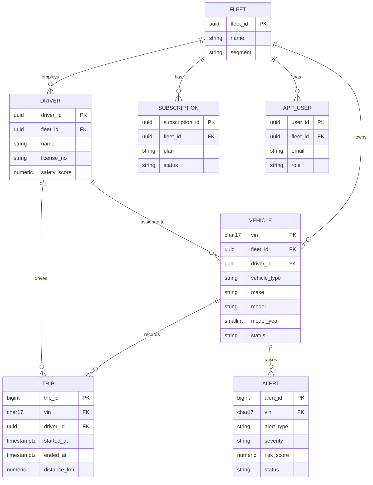

# ER Diagram — Relational Core (3NF)

Telemetry (TimescaleDB hypertable) is intentionally **not** in this diagram —
it relates to `VEHICLE` by `vin` as a soft foreign key (no DB-enforced FK
across the Postgres/Timescale boundary), keeping the high-volume time-series
store decoupled from the OLTP core. See `docs/ARCHITECTURE.md`.
